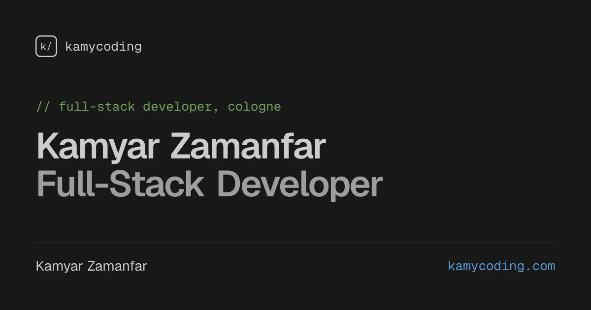
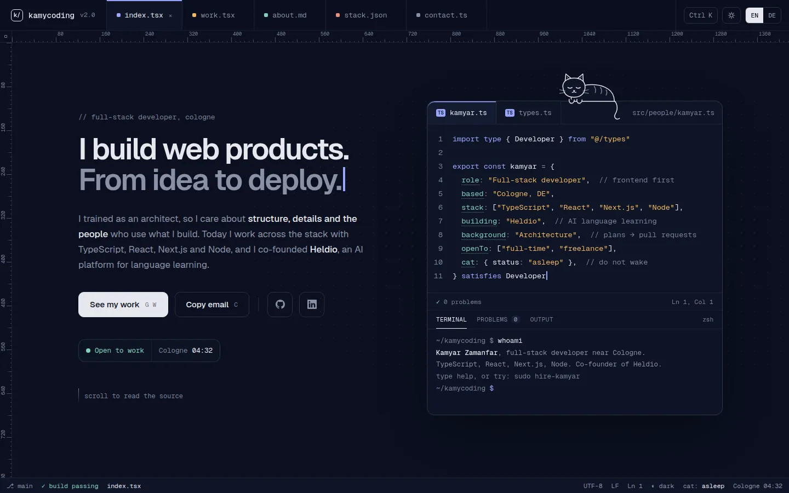
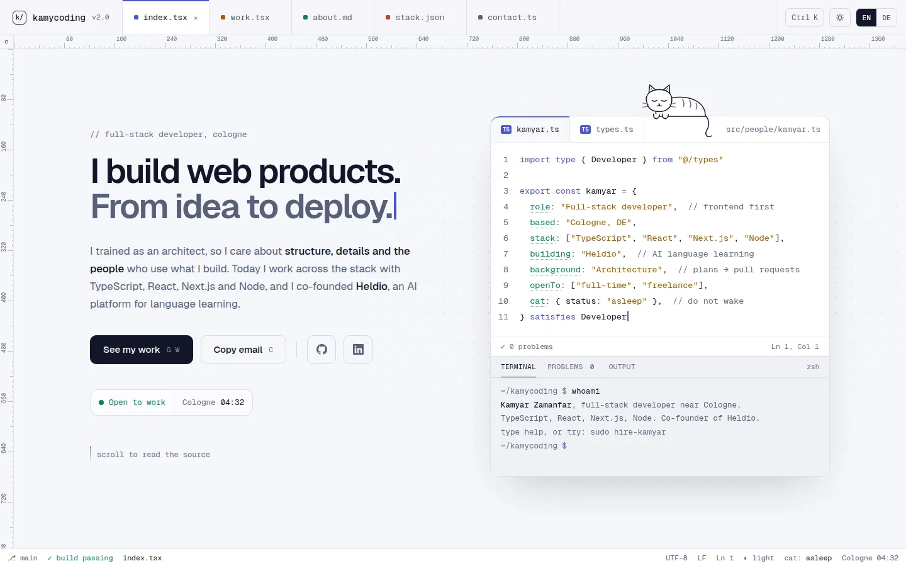
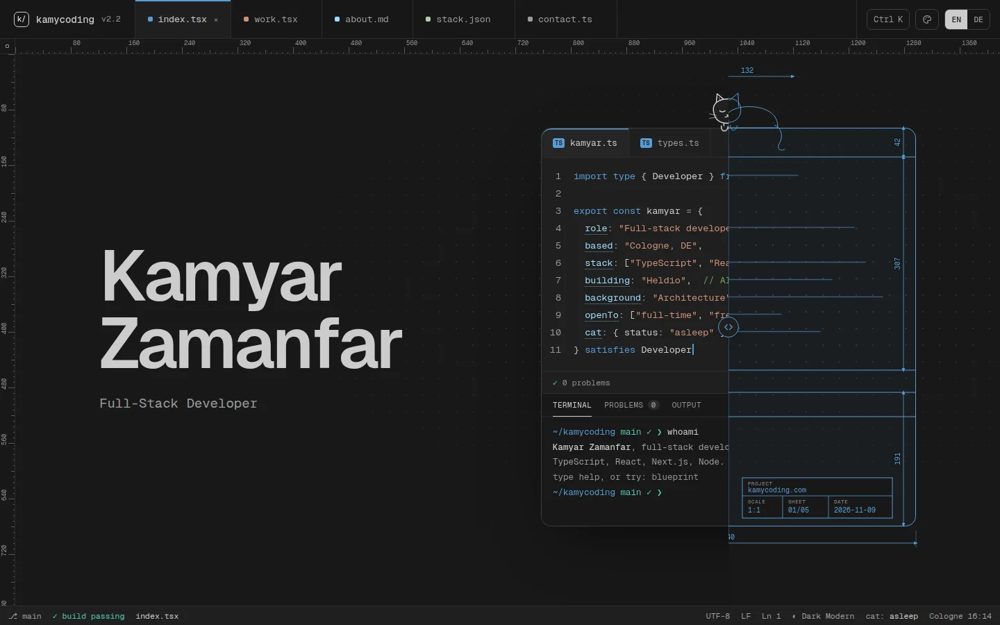
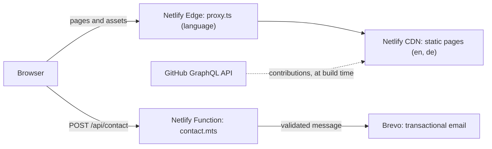

<div align="center">



# kamycoding.com

Kamyar Zamanfar, Full-Stack Developer.

[Website](https://kamycoding.com) · [v1.0.0 release](https://github.com/kamycoding/portfolio/releases/tag/v1.0.0) · [LinkedIn](https://www.linkedin.com/in/kamyarzamanfar)

[](https://github.com/kamycoding/portfolio/actions/workflows/ci.yml)
[](LICENSE)
[](.nvmrc)
[](package.json)

</div>

Personal portfolio of Kamyar Zamanfar, full-stack developer near Cologne.

<p align="center">
  
  
</p>

<p align="center">
  
</p>

## Concept

The whole site is designed as a code editor. Each section is a file (`index.tsx`, `work.tsx`, `about.md`, `stack.json`, `contact.ts`) with file tabs, rulers, breadcrumbs and a status bar. The page builds itself with a `pnpm build` log on load, and the contact form is written as a function call. It ships in English and German, in four VS Code color themes, as static pages.

## Features

- Hero with the name and role, an editor panel with TypeScript-style hover cards and a slider between a live-measured blueprint and the build, played as the entrance after the intro
- Terminal with 11 commands, a modern prompt and ghost suggestions, including `ls projects`, `git log`, `blueprint` and `theme`
- Color themes from VS Code: Dark Modern, Light Modern, Monokai and Solarized Dark, chosen in a Color Theme picker (`T`, the top bar or the status bar) with live preview; the default follows the system
- Project list as `ls -la` with a pointer preview and a README drawer per project; line-drawing covers as SVG components
- About as Markdown with an ASCII portrait, experience as a `git log` and reviews as GitHub-style pull request reviews with line-drawn avatars and an approval summary
- Stack as a VS Code style explorer (folders per group, technologies as files), a GitHub contributions grid for the last 52 weeks refreshed daily, and services as functions
- Contact form as `sendMessage({ ... })` with TypeScript-style errors, validated by the same schema in the browser and in the Netlify function
- Footer with a large "kamycoding" line drawing that draws itself once, with the cat lying on its "m"
- Command palette (`Ctrl K` / `⌘ K`), keyboard shortcuts, a custom cursor, and a cat that wakes up
- Version in the top bar and the intro, read from `package.json`
- Legal notice and privacy policy in both languages

## Tech stack

| Area                 | Tools                                                                  |
| -------------------- | ---------------------------------------------------------------------- |
| Framework            | Next.js 16 (App Router, static generation), React 19, TypeScript       |
| Styling              | Tailwind CSS v4 with design tokens, CSS Modules, Geist fonts           |
| Content              | next-intl (English at `/`, German at `/de`), next-themes               |
| Validation and tests | zod (shared schema), Vitest                                            |
| Hosting              | Netlify CDN, Netlify Functions, Brevo for email delivery               |
| Tooling              | pnpm, ESLint, Prettier, husky, lint-staged, commitlint, GitHub Actions |

## Architecture



The site has no separate backend ([ADR 0002](docs/adr/0002-no-separate-backend.md)). The only server code is the contact function: it accepts JSON from the own origin only, checks the size, validates with the shared schema, uses a honeypot and Netlify's rate limit, and logs one line per request without personal data.

| Folder                      | Contents                                                                             |
| --------------------------- | ------------------------------------------------------------------------------------ |
| `src/app/`                  | Routes and layouts per locale, design tokens, metadata, sitemap, Open Graph images   |
| `src/components/`           | Sections (`hero`, `work`, `about`, `stack`, `contact`, `legal`) and the editor shell |
| `src/content/`              | Projects, experience, reviews, stack and services in English and German              |
| `src/hooks/`, `src/lib/`    | Small shared stores and helpers, the contact schema                                  |
| `src/i18n/`, `src/proxy.ts` | Locale routing and detection ([ADR 0004](docs/adr/0004-locale-routing.md))           |
| `messages/`                 | UI copy in English and German                                                        |
| `netlify/`                  | The contact function and its tests                                                   |

## Getting started

Requirements: Node from [`.nvmrc`](.nvmrc) and pnpm, pinned in [`package.json`](package.json).

```bash
nvm use                # Node 24 from .nvmrc
corepack enable pnpm   # pnpm version from package.json
pnpm install           # also installs the git hooks
pnpm dev               # http://localhost:3000
```

| Script                        | What it does                                                                  |
| ----------------------------- | ----------------------------------------------------------------------------- |
| `pnpm dev`                    | Development server with hot reload                                            |
| `pnpm build`                  | Production build, after refreshing the GitHub contributions                   |
| `pnpm contributions:update`   | Refresh `src/content/contributions.json` (needs `GITHUB_CONTRIBUTIONS_TOKEN`) |
| `pnpm audio <slug>`           | Journal audio: a dry run by default, `--generate` calls ElevenLabs            |
| `pnpm start`                  | Serve the production build (security headers are active here)                 |
| `pnpm lint` / `pnpm lint:fix` | ESLint, with automatic fixes                                                  |
| `pnpm format`                 | Prettier on `src/`                                                            |
| `pnpm check-types`            | TypeScript check without emitting files                                       |
| `pnpm test`                   | Vitest, single run (app and contact function)                                 |

The contact function needs the variables in [`.env.example`](.env.example), set per deploy context in Netlify. There is no local Netlify setup: the function is covered by tests, and the form is tested end to end on Deploy Previews.

The contribution heatmap is fetched from the GitHub API during production builds only. Without `GITHUB_CONTRIBUTIONS_TOKEN` (local builds, Deploy Previews, forks) the build uses the committed snapshot ([ADR 0006](docs/adr/0006-github-contributions-at-build-time.md)).

Commits follow [Conventional Commits](https://www.conventionalcommits.org/). Git hooks check the message and lint and format staged files.

## Writing for the journal

The journal (`/blog`, `/de/blog`) is MDX in this repository, without a CMS ([ADR 0007](docs/adr/0007-journal-content-and-audio.md)).

1. **Draft** in `content/drafts/<slug>/`, which is gitignored and never imported by the app: `en.mdx`, `de.mdx` or both, and optionally `learning.json`.
2. **Metadata** is an export at the top of each MDX file (no frontmatter). The build checks it:

   ```js
   export const metadata = {
     title: 'At most 60 characters',
     description: 'Between 70 and 160 characters, used in search results, social cards and the feed.',
     tldr: 'Optional. One or two sentences for the TLDR block and the homepage.',
     preview: [{ kind: 'code', text: 'Optional. Up to two hook lines for the homepage card.' }], // code, comment, add or remove
     date: '2026-11-10',
     category: 'engineering', // product, design, learning, career or tools
     format: 'essay', // note, interactive, series (needs `series`) or visual
     tags: ['nextjs'],
     draft: false,
     lang: 'en'
   }
   ```

3. **Content** is Markdown plus a few components. Fenced code blocks take `filename="..."`, `{2}` and `// [!code ++]`. `<Callout type="tip">`, `<TLDR>`, `<Takeaways>` and `<Figure src={image} alt="...">` work anywhere (import the image in the MDX). `<Term id="..." />`, `<Gloss id="..." />`, `<Dialog id="..." />` and `<Quiz id="..." />` read their entry from `learning.json`; an unknown id fails the build. Interactive components for programming articles: `<OutputPuzzle code={...} lines={[...]} answer={[...]} explanation={...} />`, `<EventLoopStepper scenario="order" />` (scenarios live in `src/components/blog/mdx/event-loop-scenarios.ts`), `<AsyncRaceTimeline />` and `<MainThreadDemo />`. An optional `narration` in `learning.json` (`[{ "heading": "<h2 id>", "text": { "en": "...", "de": "..." } }]`) adds a "Listen to this article" player; `pnpm audio <slug>` lists its clips per language. The optional metadata fields `tldr` (also used by the homepage card, and by `<TLDR><p>{metadata.tldr}</p></TLDR>`) and `preview` (up to two hook lines for the homepage card: `[{ kind: 'code' | 'comment' | 'add' | 'remove', text: '...' }]`) feed the "Open editors" cards of the homepage journal section.
4. **Audio** (optional): `pnpm audio <slug> --draft` lists the German clips, characters and estimated credits without contacting anyone. `pnpm audio <slug> --draft --generate` creates them with ElevenLabs into `content/drafts/<slug>/audio/`. It needs `ELEVENLABS_API_KEY` in `.env.local`; never set it in Netlify. Voices and models live in `src/lib/blog/audio-config.ts`.
5. **Publish**: move the folder to `content/posts/<slug>/` and register each translation in `src/lib/blog/posts.ts`, with `learning` and `audio` loaders if the files exist. Then run `pnpm audio <slug>`: it should show the draft clips as `copy` and nothing as `new`, and `pnpm audio <slug> --generate` copies them into `public/blog-audio/<slug>/` without calling ElevenLabs.
6. **Check** with `pnpm build`. The sitemap, the RSS feeds (`/blog/rss.xml`, `/de/blog/rss.xml`), the Open Graph image and the structured data follow from the metadata.

## Quality and security

- CI on every push and pull request: frozen install, lint, type check, tests and build, with actions pinned to full commit SHAs
- CodeQL code scanning, Dependabot, secret scanning with push protection
- Enforced Content Security Policy and security headers ([ADR 0005](docs/adr/0005-csp-strategy.md))
- Accessibility: keyboard access everywhere, visible focus, reduced motion respected, text contrast at WCAG AA in every color theme
- [`security.txt`](public/.well-known/security.txt) and a [security policy](SECURITY.md) for private reports

## Architecture decisions

- [ADR 0001: Move the portfolio from Angular to Next.js](docs/adr/0001-migrate-angular-to-nextjs.md)
- [ADR 0002: No separate backend for the portfolio](docs/adr/0002-no-separate-backend.md)
- [ADR 0003: Replace the Zolt UI with a custom editor design](docs/adr/0003-custom-editor-design.md)
- [ADR 0004: Locale routing with next-intl](docs/adr/0004-locale-routing.md)
- [ADR 0005: Content Security Policy strategy](docs/adr/0005-csp-strategy.md)
- [ADR 0006: GitHub contributions at build time](docs/adr/0006-github-contributions-at-build-time.md)

The design spec and the approved prototype are in [`docs/design/`](docs/design/), the phase plan in [`docs/ROADMAP.md`](docs/ROADMAP.md).

## Versions

- v1 (Angular) is preserved at [`v1.0.0`](https://github.com/kamycoding/portfolio/releases/tag/v1.0.0).
- v2 went live with [`v2.0.0`](https://github.com/kamycoding/portfolio/releases/tag/v2.0.0). The current release is [`v2.2.0`](docs/release-notes/v2.2.0.md). Changes are listed in the [changelog](CHANGELOG.md).

## License

- Source code: MIT.
- Content (texts, photos, the design, illustrations and the cat): all rights reserved.

See [LICENSE](LICENSE) for both parts.

## Credits

- v2 started from the free Zolt template by shadcn/studio (MIT). The UI was replaced by the custom editor design ([ADR 0003](docs/adr/0003-custom-editor-design.md)); [LICENSE.md](LICENSE.md) keeps its notice.
- [Geist](https://vercel.com/font) fonts by Vercel.

## Contact

- Website: [kamycoding.com](https://kamycoding.com)
- LinkedIn: [kamyarzamanfar](https://www.linkedin.com/in/kamyarzamanfar)
- Email: [contact@kamycoding.com](mailto:contact@kamycoding.com)
- Contributions: see [CONTRIBUTING.md](CONTRIBUTING.md) and the [code of conduct](CODE_OF_CONDUCT.md)
